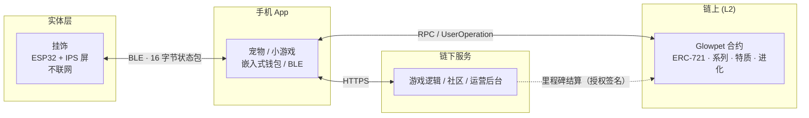
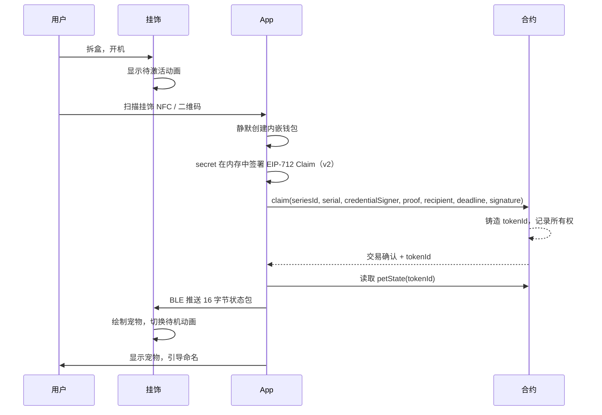

# Glowpet 灵宠 · 产品需求文档（PRD）

| 项目 | 内容 |
| --- | --- |
| 文档版本 | v0.3（Draft，领取协议 v2 + 本地养成） |
| 更新日期 | 2026-10-20 |
| 作者 | Yuxiang Wang |
| 状态 | 待评审 |
| 适用范围 | 本文档同时服务于**课程交付**与**后续产品化评估**。第 6 章的 P0 为课程范围，P1/P2 为产品路线图。 |

**当前实现与目标的区别**

当前仓库实现的是 Sepolia 浏览器 MVP：MetaMask 连接、领取、链上宠物展示与动画、编号/凭证生成、每 5 秒同步状态的浏览器挂饰模式，以及本地种植/收获/喂食/陪玩循环。已加入凭证、防发布、浏览器授权回归测试和 Hardhat 本地合约测试。本文中的内嵌钱包、免 gas、真实 BLE 与服务端里程碑结算属于后续交付目标。领取协议已改为 v2，新的 Sepolia 部署、Etherscan 源码验证及真实钱包端到端领取仍须单独验收。

本轮按用户要求只生成新的 v2 凭证，不部署：Sepolia（11155111）、系列 1、100 件，输出目录 `deployments/series-1-v2-20261020/`，100 份 proof 已逐一验证。公开参数见 `docs/v2-series.json`；旧凭证、旧本地链均保留。

2026-10-20 视觉定稿：用户选定 A「奶油软糯」方向，并确认小兔、小猫、小狐狸、小鼠、小羊为 **DeltaX 系列基础模型**。登记见 [`deltax-base-models.json`](deltax-base-models.json)，形象基准见[家族稿](../output/glowpet-concepts/A-family-v1.png)。此处“基础模型”指已确认的角色视觉基准；现已从概念稿制作五款透明角色素材，接入访客花园和无已铸造宠物时的首页预览；提供轻呼吸、慢摇、星点明暗起伏、不均匀短眨眼（含轻双眨）、左右耳错峰轻动、主动播放/暂停及喂食/陪玩动作反馈。眼耳按各物种位置局部变形，保留原始透明素材；页面隐藏时暂停表情动画。形象选择只改变预览，不重置养成存档。链上渲染及按 token 组合部件尚未更新。新增特征方案见 9.3.1。

2026-10-20 验证记录：生产构建通过；29 项 Node 回归测试通过（包含 18 项养成规则与存档测试），前轮 16 项本地 EVM 测试通过。FaceArt / Art / Glowpet 部署字节码分别为 20,189 / 24,053 / 11,844 字节，均低于 24,576 字节上限。浏览器已验证旧版凭证提示、宠物详情、挂饰自动同步和深链刷新恢复；本轮完成访客花园的种植、成熟收获、喂食、陪玩、刷新存档及手机布局检查。此记录不代表 v2 已部署到 Sepolia，也不代表第三方安全审计完成。

v2 将挂饰 `secret` 作为单个凭证的 secp256k1 私钥，仅在领取时进入浏览器内存，用来签署指定收款人的授权；它不是用户钱包私钥。应用不读取钱包私钥，也不将挂饰私钥写入 calldata、日志或浏览器持久存储。凭证文件和链接标记 `protocolVersion=2`，应用要求合约 `claimProtocolVersion() == 2`。**旧合约、旧 root 与旧 proof 不兼容，必须重新生成 v2 凭证、部署新合约并创建系列；现有 NFT 不会自动迁移。**

**一句话定位**

> Glowpet 灵宠是一款限量发行的实体挂饰：挂饰的屏幕里住着一只**永远只属于你**的链上宠物。它由挂饰编号唯一决定，能被照顾、能进化，也能被带走。

**电梯陈述**

实体潮玩的问题是"买完就结束"，虚拟宠物的问题是"公司关服就消失"。Glowpet 把两者接起来：挂饰是入口和显示屏，链上 NFT 是所有权和履历。每一期系列的上限写在合约里，我们自己也改不了——这是"限量"第一次变成可以被验证的事实，而不是一句营销文案。

---

## 1. 背景与问题

### 1.1 市场现状

| 品类 | 代表 | 优势 | 结构性缺陷 |
| --- | --- | --- | --- |
| 实体潮玩 / 盲盒 | 泡泡玛特、BE@RBRICK | 手感、陈列、社交货币 | 买完即结束；玩家与作品无持续关系；二级市场依赖平台 |
| 电子宠物 | Tamagotchi、拓麻歌子 | 陪伴感、养成循环 | 单机孤岛；数据在公司手里；无稀缺性证明 |
| 链上 NFT 宠物 | Axie、CryptoKitties | 所有权、可交易、可验证稀缺 | 纯数字、无实体锚点；门槛高；体验差 |

三者的空隙是同一件事：**没有一个产品同时做到"实体可触摸"、"宠物有生命感"、"所有权可验证"。**

### 1.2 我们要解决的问题

1. 实体收藏品缺少持续的生命周期，购买是关系的终点而不是起点。
2. 虚拟宠物的资产不属于用户，运营方关停即归零。
3. "限量"无法被验证，消费者只能选择相信品牌。

### 1.3 为什么是现在

- L2 手续费降到可以忽略（单笔 ~$0.001–0.01），让十万级消费应用在经济上成立。
- 账户抽象（ERC-4337）让"没有钱包、没有 gas"的用户也能真正持有资产。
- BLE + 低成本 IPS 屏（ESP32-C3 方案）让实体端硬件成本进入消费级区间。

---

## 2. 目标与非目标

### 2.1 产品目标

| 编号 | 目标 | 衡量方式 |
| --- | --- | --- |
| G1 | 让用户在 60 秒内完成"拆盒 → 激活 → 宠物出现在挂饰上" | 首次激活完成率 ≥ 85% |
| G2 | 让每只宠物在视觉上独一无二且可被验证 | 同系列 10 万只，可感知碰撞 ≤ 0.001% |
| G3 | 让"限量"成为可验证事实 | 系列关闭后任何地址（含运营方）均无法增发 |
| G4 | 让用户真正拥有可带走的资产 | 私钥可导出；宠物可转让；链上所有权独立于本服务 |
| G5 | 建立可持续的养成循环 | D7 留存 ≥ 25%，日均互动 ≥ 1.5 次 |

### 2.2 非目标（明确不做）

- **不做链上麻将/棋牌。** 隐藏信息、高频交互与 gas 成本决定它不适合上链。
- **不做加密货币钱包的通用场景。** 本产品的钱包只服务于宠物资产，不提供兑换、转账引导。
- **不做二级市场撮合。** MVP 只保证资产可转让，交易平台依赖现有市场（OpenSea 等）。
- **不做盲盒随机性。** 宠物由编号确定性生成，不设"抽卡"（见 9.3 的取舍说明）。
- **不做 L1 部署。** 成本不成立。

---

## 3. 用户与场景

### 3.1 目标用户

| 画像 | 特征 | 核心诉求 | 对产品的意义 |
| --- | --- | --- | --- |
| **A. 潮玩收藏者**（主力） | 18–30 岁，买过潮玩/挂件，重视设计与稀缺 | 好看、独特、可展示、有收藏序列感 | 决定外观与包装；贡献首购 |
| **B. 陪伴型玩家** | 玩过电子宠物/养成游戏 | 宠物会回应我、陪我玩、成长可见 | 决定留存与日常互动 |
| **C. Web3 用户**（次要但关键） | 有钱包，关心可验证性与流动性 | 能验证合约、能转售、能接入其他应用 | 提供可信度与二级市场 |

**非目标用户**：需要"投资回报"承诺的用户。本产品不做收益预期，避免合规与预期风险。

### 3.2 Jobs To Be Done

- 当我买到一个喜欢的挂件时，我希望它**不只是摆设**，而是有东西在陪我。
- 当我养一只宠物时，我希望它**只属于我**，不会因为平台关停而消失。
- 当我展示收藏时，我希望别人能**验证它是真的限量**，而不是听我口说。
- 当我厌倦时，我希望**能把它转手**，而不是烂在账号里。

### 3.3 典型场景

1. **开箱**：拆开包装 → 扫 NFC/二维码 → 宠物出现在手机和挂饰屏上（< 60 秒）。
2. **日常**：通勤时挂饰自己眨眼、小动作；打开 App 喂食、收菜。
3. **成长**：达到里程碑 → 链上记录进化 → 挂饰屏幕换形态（这是核心"惊艳时刻"）。
4. **社交**：在社区里看到别人的宠物，比较系列与编号。
5. **流转**：把宠物转让给朋友，或挂到二级市场。

---

## 4. 价值主张：为什么必须是区块链

这是本产品最容易被质疑的地方，也是答辩必答题。**如果以下四条不成立，数据库就够了。**

| 价值 | 说明 | 用户可验证方式 |
| --- | --- | --- |
| **稀缺性不可篡改** | 每期上限写在合约，关闭后永久不可增发，运营方也做不到 | 区块浏览器查看 `maxSupply` / `minted` / `open` |
| **所有权独立于服务** | 宠物属于地址，不属于我们的数据库；服务停止不影响资产 | 在任意钱包/市场查看 `ownerOf` |
| **履历永久** | 领取、进化、转让历史在链上可追溯 | 事件日志 |
| **可组合、可流转** | 其他应用可读取宠物状态；可转让/转售 | 开放 ABI 与标准 ERC-721 |

**明确不承诺**：不承诺升值、不承诺回购、不做金融化。

---

## 5. 产品架构总览



**三条架构原则**

1. **挂饰是哑终端。** 不联网、不知道区块链，只负责显示和动画。断电/断网不影响资产。
2. **链上只放"值得永久留证"的东西。** 身份、所有权、系列、进化里程碑。
3. **链下承担所有高频与隐藏信息。** 小游戏、社区、日常喂食。

---

## 6. 范围与优先级

### 6.1 P0 — 课程交付（必须完成，可演示）

| 模块 | 交付内容 |
| --- | --- |
| 合约 | `Glowpet.sol`（系列、编号领取、特质推导、`petState`、进化）+ `GlowpetArt.sol`（链上 SVG）+ `GlowpetFaceArt.sol`（五官/配饰，因 24KB 限制拆分） |
| 部署 | Sepolia 测试网部署 + Etherscan 验证（顺序：FaceArt → Art → Glowpet） |
| Web App | 领取、宠物展示与 SVG 动画、凭证链接解析、交易记录（内嵌钱包为下一步） |
| 挂饰模拟 | 浏览器"挂饰模式"窗口，实时反映链上状态变化 |
| 链下游戏 | 1 个完整循环（种植 → 等待 → 收获），数据存本地/服务端 |
| 测试 | 自动化行为测试：系列上限、重复领取、签名篡改/抢跑、进化、转让；生成器与构建防泄露回归测试 |
| 文档 | 本 PRD + README（架构、部署步骤、链上/链下边界） |

**当前 MVP 验收路径**：使用 MetaMask 领取，展示链上宠物，再由合约管理员进化；挂饰模拟屏自动更新。只读宠物与挂饰预览无需钱包。v2 的公开测试网部署与这条完整路径仍需实际验收。

**后续课程目标**：评委无需安装 MetaMask，通过邮箱/访客模式完成"领取 → 看到宠物 → 进化 → 挂饰模拟屏变化"，并能在 Etherscan 上核对所有权与事件。内嵌钱包与免 gas 目前尚未实现。

### 6.2 P1 — 试点（首批发售，500–2,000 件）

- 真实硬件固件 + BLE 配对
- NFC/二维码领取凭证
- ERC-4337 智能账户 + Paymaster（免 gas）
- 进化里程碑结算服务
- 生产级内嵌钱包（Privy/Dynamic）

### 6.3 P2 — 商业化与生态

- 社区与多人玩法（链下为主）
- 二级市场与版税（ERC-2981）
- 多系列并行与跨系列联动
- ERC-6551：宠物自身持有资产
- OTA 固件升级

---

## 7. 核心用户旅程

### 7.1 首次激活（关键路径，目标 < 60 秒）

以下为包含内嵌钱包与真实硬件的目标流程；当前版本使用 MetaMask 和浏览器挂饰模拟。



**目标设计**：钱包创建对用户不可见；用户不需要任何 ETH。当前浏览器 MVP 使用 MetaMask，用户需要 Sepolia 测试 ETH 提交交易；挂饰凭证签名由应用在内存中完成。

### 7.2 日常养成

打开 App → 查看宠物状态 → 喂食/收菜（链下，即时）→ 累计经验 → 达到里程碑 → 触发链上 `evolve` → 事件确认 → 挂饰屏幕形态变化。

**注意**：进化上链、喂食不上链。这是 gas 与"惊艳时刻"的平衡点（见 9.1）。

当前可玩流程：Garden → 三块田地种植 → 30/60/120 秒后收获 → 获取食物、花园金币与羁绊经验 → 喂食/陪玩 → 提升本地养成等级。免费胡萝卜确保金币耗尽也能继续。游客无需钱包，真实宠物可从详情进入独立养成记录；记录按链、合约、token 与链上所有者隔离，保存在本机。刷新或离开页面后，作物仍按经过时间成熟。150/400/900 XP 里程碑仅标记本地达标，不调用 `evolve`，也不会改变链上阶段。花园金币不可兑换、不可转移，清理浏览器数据会丢失养成记录。当前是网页模块，未发布微信小程序。

### 7.3 转让

用户在 App 内发起转让 → 链上转移 → 挂饰不再显示该宠物（App 侧校验所有权）→ 新主人可绑定自己的挂饰。

---

## 8. 功能需求

> 每条需求附带验收标准（AC）。优先级：P0 / P1 / P2。

### 8.1 智能合约（FR-C）

| 编号 | 需求 | 验收标准 | 优先级 |
| --- | --- | --- | --- |
| FR-C-01 | **系列建模**：每个系列有 `maxSupply`、`minted`、`open`、`salt`、`label` | `minted` 永远 ≤ `maxSupply`；`open=false` 后任何领取均 revert `SeriesNotOpen` | P0 |
| FR-C-02 | **编号领取 v2**：用户凭 `serial` + 挂饰私有 `secret` + Merkle proof 领取，一个 serial 仅一次 | `credentialSigner = computeAddress(secret)`；叶子为 `keccak256(abi.encode(block.chainid, seriesId, serial, credentialSigner))`；旧 proof 不可跨系列/跨链复用；重复领取 revert `AlreadyClaimed`；无效 proof revert `InvalidProof`；未开放 revert `SeriesNotOpen` | P0 |
| FR-C-12 | **防抢跑签名 v2**：由挂饰凭证私钥签署 EIP-712 Claim，字段为 `seriesId / serial / recipient / deadline`，domain 为 `Glowpet / 2 / chainId / verifyingContract` | calldata 仅含公开 signer、proof 与签名，不含 secret；复制交易只能向已授权 recipient 铸造；篡改 recipient、series、serial 或 domain 均失败；过期签名 revert `SignatureExpired` | P0 |
| FR-C-03 | **tokenId 编码**：`tokenId = seriesId * 1_000_000 + serial` | 可从 tokenId 还原 seriesId 与 serial；不同系列/编号不冲突 | P0 |
| FR-C-04 | **特质推导**：特质由 `keccak256(abi.encode(tokenId))` 确定性生成 | 同 tokenId 永远得到同一组特质；不同 tokenId 的视觉签名碰撞率 < 0.01% | P0 |
| FR-C-05 | **链上元数据**：`tokenURI()` 返回 base64 JSON，内嵌 base64 SVG | 在 OpenSea/钱包中可直接显示；无外部 URL 依赖 | P0 |
| FR-C-06 | **状态读取**：`petState(tokenId)` 返回压缩结构体 | App/固件无需解析 SVG；与 `tokenURI` 同源 | P0 |
| FR-C-07 | **进化**：达到里程碑后由授权方签名触发 | 非授权地址无法调用；同一阶段不可重复进化；事件可追溯 | P0 |
| FR-C-08 | **可转让**：标准 ERC-721 转移 | `transferFrom`/`safeTransferFrom` 正常；转移后 `ownerOf` 更新 | P0 |
| FR-C-09 | **总量不膨胀**：系列一旦关闭不可重开 | 关闭后无任何管理函数可增发 | P0 |
| FR-C-10 | **事件**：`Claimed`、`Evolved`、`Transfer` | 事件字段足以重建历史 | P0 |
| FR-C-11 | **合约体积**：部署字节码 < 24,576 字节 | 编译后检查；超限则拆分渲染库 | P0 |

### 8.2 领取与实体绑定（FR-B）

| 编号 | 需求 | 验收标准 | 优先级 |
| --- | --- | --- | --- |
| FR-B-01 | 每件挂饰携带唯一 `serial`、有效 secp256k1 私钥 `secret` 与领取凭证（NFC/二维码） | 扫描即可读取；root、signer、proof 可公开，缺少 secret 无法签署其他 recipient；凭证含 `protocolVersion=2` | P0（模拟）/P1（硬件） |
| FR-B-02 | 凭证以 Merkle 树批量上链，仅存 root；secret 不上链、不入事件 | `scripts/build-serials.mjs` 从随机主 seed 确定性派生凭证并可复现 v2 root；拒绝向 `public/` 或其符号链接写入；构建拦截 JSON/CSV/seed 等凭证导出 | P0 |
| FR-B-03 | 一个 `serial` 只能领取一次 | 重复领取被合约拒绝 | P0 |
| FR-B-04 | 领取后凭证失效 | 再次扫描提示"已激活"，并展示当前所有者 | P1 |

### 8.3 钱包与账户（FR-W）

| 编号 | 需求 | 验收标准 | 优先级 |
| --- | --- | --- | --- |
| FR-W-01 | **静默创建**：首次打开 App 自动生成钱包，无需用户理解"钱包" | 用户全程不输入助记词；< 3 秒完成 | P0 |
| FR-W-02 | **密钥可导出**：设置页提供导出私钥/助记词 | 导出后可导入 MetaMask 并看到宠物 | P0 |
| FR-W-03 | **免 gas**：用户无需持有原生代币 | 新用户 0 余额仍可完成领取/进化 | P0（运营方代付）/P1（Paymaster） |
| FR-W-04 | **会话授权**：一次授权后可连续操作 | 不逐次弹窗 | P2 |
| FR-W-05 | **恢复机制**：换机可找回 | 邮箱/社交恢复流程可用 | P2 |
| FR-W-06 | **安全边界**：不读取用户钱包私钥，不发布主 seed、批量凭证或 API 密钥；单个挂饰私钥仅在领取时进入内存 | 代码、构建产物、calldata、日志与浏览器持久存储均无领取私钥；钱包交易通过 MetaMask 授权 | P0 |

> 后续钱包目标：可评估 demo-only 的内嵌钱包与运营方代付方案，但当前没有实现钱包生成、密钥导出或 gas 代付。它们与 v2 挂饰凭证私钥是不同功能，不能将扫码凭证当作资产钱包使用。

### 8.4 移动 App（FR-A）

| 编号 | 需求 | 验收标准 | 优先级 |
| --- | --- | --- | --- |
| FR-A-01 | 宠物主页：形象、编号、系列、等级、状态 | 数据来自链上；刷新后一致 | P0 |
| FR-A-02 | 喂养/互动（链下） | 即时反馈，不发交易 | P0 |
| FR-A-03 | 小游戏：种植→收获循环 | 完整可玩；收益计入链下货币 | P0 |
| FR-A-04 | 挂饰配对与同步 | 配对成功后 < 1 秒内屏幕更新 | P0（模拟）/P1（硬件） |
| FR-A-05 | 进化操作与进度 | 达到条件可进化；未达条件给出明确提示 | P0 |
| FR-A-06 | 资产历史 | 展示领取、进化、转让记录，附区块浏览器链接 | P1 |
| FR-A-07 | 社区/好友 | 查看他人宠物、分享 | P2 |

### 8.5 挂饰与 BLE（FR-P）

| 编号 | 需求 | 验收标准 | 优先级 |
| --- | --- | --- | --- |
| FR-P-01 | 挂饰作为 BLE 外设，暴露自定义 GATT 服务 | 手机可发现、连接、订阅 | P1 |
| FR-P-02 | 接收 16 字节状态包并校验 | 长度/版本/校验错误时不绘制并回 NACK | P1 |
| FR-P-03 | 本地待机动画 | 断网/断连仍持续播放；帧率 ≥ 15fps | P1 |
| FR-P-04 | 低电量模式 | 电量低于阈值降低帧率/亮度 | P1 |
| FR-P-05 | 开机/未激活态 | 未领取时显示引导动画 | P1 |
| FR-P-06 | 续航 ≥ 7 天（典型使用） | 200mAh 电池实测 | P1 |

### 8.6 链下游戏与社区（FR-G）

| 编号 | 需求 | 验收标准 | 优先级 |
| --- | --- | --- | --- |
| FR-G-01 | 游戏逻辑完全链下 | 单次操作响应 < 200ms | P0 |
| FR-G-02 | 里程碑结算上链 | 仅在进化/稀有奖励时发交易 | P0 |
| FR-G-03 | 防作弊：服务端裁决 | 客户端不可直接改写进度 | P1 |
| FR-G-04 | 链下货币与链上资产分离 | 货币不可兑换为代币；页面明确说明 | P0 |

### 8.7 运营后台（FR-O）

| 编号 | 需求 | 验收标准 | 优先级 |
| --- | --- | --- | --- |
| FR-O-01 | 创建系列、生成 serial 与 Merkle root | 脚本可复现；root 上链后可验证 | P1 |
| FR-O-02 | 关闭系列 | 关闭后链上确认无法增发 | P0 |
| FR-O-03 | Paymaster 余额与白名单监控 | 异常调用告警 | P1 |
| FR-O-04 | 基础数据看板 | 领取率、活跃、链上成本 | P2 |

---

## 9. 系统与数据架构

### 9.1 链上 / 链下边界（必须能讲清楚）

| 数据 | 位置 | 理由 |
| --- | --- | --- |
| 系列参数（上限、已发、开关） | **链上** | 稀缺性必须可验证 |
| tokenId ↔ serial 映射 | **链上** | 实体与数字的唯一绑定 |
| 所有权 | **链上** | 资产的核心定义 |
| 宠物特质 | **链上推导**（不存储） | 零存储成本，十万级可扩展 |
| 进化阶段 | **链上** | 永久履历，且驱动挂饰画面 |
| 等级/经验 | 链下为主，里程碑上链 | 高频更新不值得发交易 |
| 链下货币 | **仅链下** | 不作为资产，避免证券化与投机 |
| 小游戏进度 | **仅链下** | 高频、需隐藏信息 |
| 社区内容 | **仅链下** | 成本与合规 |

### 9.2 合约接口（草案）

```solidity
// 系列
function createSeries(
    uint256 seriesId, uint64 maxSupply, uint32 salt, bytes32 serialRoot, string calldata label
) external;
function closeSeries(uint256 seriesId) external;

// 领取 v2：secret 来自挂饰 NFC/二维码，仅在内存中签名，不进 calldata。
// credentialSigner = computeAddress(secret)，其地址写入 Merkle leaf。
// Claim 字段：uint256 seriesId, uint32 serial, address recipient, uint256 deadline。
// EIP-712 domain：name="Glowpet", version="2", chainId, verifyingContract。
function claimProtocolVersion() external pure returns (uint256); // 2
function claim(
    uint256 seriesId,
    uint32 serial,
    address credentialSigner,
    bytes32[] calldata proof,
    address recipient,
    uint256 deadline,
    bytes calldata signature
) external returns (uint256 tokenId);

// 读取
function petState(uint256 tokenId) external view returns (
    uint8 species, uint8 palette, uint8 eyeStyle, uint8 mouthStyle,
    uint8 accessory, uint8 eyewear, uint8 frameColor,
    uint8 stage, uint8 bodyShape, int8 tilt,
    uint16 level, uint32 serial, uint256 seriesId
);
function tokenURI(uint256 tokenId) external view returns (string memory);

// 进化（MVP 为 onlyOwner；生产改为授权签名/里程碑服务）
function evolve(uint256 tokenId, uint8 newStage) external;

// 标准 ERC-721 转让能力保留
```

v1 曾将 `secret` 放进 calldata，再由收款人签名；观察者取得 secret 后可以给自己的地址重新签名，因此不能提供防抢跑保证。v2 用挂饰私钥签署收款授权，链上只验证其公开地址及签名。迁移时必须保留旧输出、在新私有目录生成 v2 凭证并部署新合约；更换前端版本不会升级旧合约或使旧 root 兼容。

### 9.3 当前 14 物种渲染器的特质生成规范

**输入**：`tokenId = seriesId * 1_000_000 + serial`

**种子**：`h = uint256(keccak256(abi.encode(tokenId)))`（必须用 `abi.encode`，不用 `encodePacked`）

**字节分配**（从最低字节 b0 起，JS 与 Solidity 必须严格一致）：

| 字节 | 字段 | 映射 |
| --- | --- | --- |
| b0 | 调色板 | `_paletteFor(species, b0)`（按物种约束，避免绿熊猫/蓝青蛙） |
| b1 | 背景变体 | `b1 % 3` |
| b2 | 头部缩放 | `940 + b2 * 120 / 255`（千分比） |
| b4 | 耳型 | `b4 % 2` |
| b5 | 眼距 | `920 + b5 * 160 / 255`（千分比） |
| b6 | 眼大小 | `920 + b6 * 160 / 255`（千分比） |
| b7 | 眼型 | `b7 % 6` |
| b8 | 嘴型 | `b8 % 3` |
| b9 | 腮红 | `b9 % 2` |
| b10 | 花纹 | `b10 % 3` |
| b11 | 花纹数量 | `3 + b11 % 3` |
| b12 | 配饰 | `b12 % 6` |
| b13 | 花纹随机种子 | 直接使用 |
| b14 | 头型轮廓 | `b14 % 2` |
| b15 | 头部倾斜 | `(b15 % 7) - 3` |
| b16 | 物种 | `b16 % 14` |
| b17 | 眼镜 | `b17 % 6` |
| b18 | 镜框颜色 | `b18 % 6` |

**唯一性保障**

1. 物种（14）× 调色板（受物种约束）× 眼型（6）× 嘴型（3）× 配饰（6）× 眼镜（6）× 头型 × 倾斜 × 缩放 × 眼距/眼大小的组合空间远大于 10 万。
2. 序列号以水印形式绘制在图案中，**视觉唯一性由定义保证**。
3. 14 物种原型验证：100,000 个 tokenId 在量化后的视觉签名层面 **0 碰撞**（100,000/100,000 唯一）。

**取舍说明（必须写进答辩）**：特质由 tokenId 确定性推导，意味着**铸造前即可算出**，没有"抽卡"随机性。这是刻意选择——宠物属于挂饰编号，而不是赌博机制；也避免了随机数被 grind 的安全问题。若未来需要随机稀有度，应引入 VRF 或 commit-reveal。

### 9.3.1 DeltaX 软糯系列：已确认的基础模型与拟议特征

**已确认范围**：设计版本 `deltax-soft-v1`，以 [A 家族稿](../output/glowpet-concepts/A-family-v1.png)、[兔子稿](../output/glowpet-concepts/A-soft-sweet.png)与[小鼠细化稿](../output/glowpet-concepts/A-mouse-detail-v1.png)为视觉基准。小鼠参考了用户提供的麦小鼠的大圆耳、银灰色、额前体积和害羞眼神；家族稿中的动物化小鼠为本系列基准。

| 基础模型 | 沿用的物种编码 | 必须保留的识别特征 | 可按 tokenId 变化的方向（提案） |
| --- | --- | --- | --- |
| 小兔 | 2 | 圆厚耳朵、一侧折耳、奶油色宽圆脸 | 折耳弧度、耳心颜色、浅色局部毛斑 |
| 小猫 | 0 | 短圆三角耳、饱满脸颊、极小猫鼻猫嘴 | 奶油/浅饼干配色、额纹与尾尖 |
| 小狐狸 | 4 | 较高三角耳、奶白面罩、奶白尾尖 | 杏桃色深浅、面罩边缘、尾尖范围 |
| 小鼠 | 9 | 大圆耳、粉色耳心、银灰软毛簇、害羞眼睛 | 银灰/暖米灰配色、额毛弧度、耳心与眼睛色调 |
| 小羊 | 7 | 大块云朵羊毛、横向垂耳、光滑小脸 | 奶白/浅燕麦配色、羊毛大块轮廓、耳尖颜色 |

**保持可爱感的组合原则**：固定宽圆头团、低位五官、两只小爪子和画面右侧脸颊的小暖光星；毛色、轮廓微调和局部花纹只在经过审美筛选的范围内变化。星斑不遮五官。减少大面积深色花纹、强饱和色及遮脸配饰。权重、稀有款数量和各部件枚举尚未定稿。

**实现提案**：`tokenId → 确定性种子 → 物种专属参数/部件 → 同一角色渲染`。同一系列身份、tokenId 与冻结后的规则版本，始终得到相同的固有外观；刷新、转让或换设备不改变固有特征。开心、困倦、互动动作属于独立状态层，成长阶段仍由对应的成长记录控制。普通展示不重新请求 AI 生成角色。

**现状与实施边界**：

- 当前合约对所有系列使用同一套 14 物种规则；仅将系列标签改为 DeltaX 不会启用这五个模型。上表保留既有物种编码，避免前端把新物种序号误读为旧物种；五物种选择规则须单独实现并冻结。
- 不直接把现有规则的 `% 14` 改成 `% 5` 来重新解释已存在的 NFT。既有部署的 `art` / `faceArt` 地址不可修改；新规则与新画风需要独立版本及新的部署安排。本轮没有修改运行中的生成规则、凭证或部署状态。
- 批准的图片提供风格与比例基准，还需制作可组合图层或参数化绘图部件。若继续保留“链上直接生成 SVG、无外部图片依赖”的目标，须实现相应的 SVG 渲染器；精细绒感到小屏的还原程度以实测为准。
- tokenId 唯一不代表离散特征组合或肉眼观感自动唯一。发布前须按计划发行量批量生成，检查组合碰撞、各物种分布和缩小后的可辨认差异；编号不同不计作角色外观差异。旧 14 物种原型的碰撞记录不能作为新五物种系列的验证结果。
- 固定规则发布前需要验证重复渲染一致、前端与合约参数一致、240×240 小屏辨识度、动画分组兼容和合约体积限制。

### 9.4 BLE 协议

- 挂饰为 **peripheral**，手机为 **central**。
- 服务与特征：`STATE`（write-with-response，16 字节）、`ACK`（notify，1 字节）。
- 状态包恰好 16 字节，可在默认 ATT MTU（23 → 20 字节负载）下**单包传完**，无需分包重组。
- 断线重连后手机重推一次；挂饰不持久化身份，只持久化最后一次状态。

**ACK 码**：`0x00` OK / `0x01` 长度错误 / `0x02` 版本不支持 / `0x03` 校验失败 / `0x04` 忙。

> 完整包结构见附录 A。

---

## 10. 硬件规格

### 10.1 BOM（首版估算，需打样确认）

| 部件 | 建议型号 | 数量 | 预估成本（RMB） |
| --- | --- | --- | --- |
| 主控（BLE） | ESP32-C3-MINI-1 / nRF52840 | 1 | 10–20 |
| 显示屏 | 1.3" 240×240 IPS（ST7789） | 1 | 12–20 |
| 电池 | LiPo 150–300mAh | 1 | 6–10 |
| 充电管理 | TP4056 | 1 | 1–2 |
| PCB | 4 层小板 | 1 | 5–10 |
| 结构件/外壳 | 注塑或 3D 打印 | 1 | 8–20 |
| NFC 标签 | NTAG213 | 1 | 1–2 |
| 组装/测试 | — | — | 5–10 |
| **合计（BOM）** | | | **约 48–94** |

### 10.2 硬件约束

- 屏幕刷新与背光是主要耗电项，待机动画需降帧率。
- 挂饰**不联网**，不承担任何链上交互，降低功耗与安全面。
- 结构上需保留无线充电或磁吸充电方案（P1 决定）。

### 10.3 屏幕与渲染

- 分辨率：240×240（首选）或 160×128。
- 固件绘制图元：圆、椭圆、弧线、渐变、文本。
- 与 App 的预览必须使用同一套比例与调色板规范，避免"手机好看、挂饰变形"。

---

## 11. 非功能需求

| 类别 | 要求 |
| --- | --- |
| **性能** | 领取到挂饰显示 < 5 秒（含链上确认）；BLE 同步 < 1 秒；链下操作 < 200ms |
| **成本** | 单次链上操作 ≤ $0.01（L2）；单用户全生命周期链上成本 ≤ $0.05 |
| **可靠性** | 合约交互成功率 ≥ 99%；领取失败可重试且不重复扣费 |
| **安全** | 未来 Paymaster 仅允许目标合约 + 白名单方法并按账户限流；当前应用不接触钱包私钥，挂饰私钥仅在内存中签名，不进入发布产物或 calldata |
| **隐私** | 链上地址与行为公开可见；App 不收集非必要个人信息；首次引导需说明 |
| **合规** | 不做收益承诺、不做代币发行；不同司法辖区监管不同，**上线前须法务评估**（尤其涉及数字藏品/虚拟货币的地区） |
| **可访问性** | 关键按钮支持大字号；颜色对比度达标 |
| **可维护性** | 合约可升级性刻意不引入（不可篡改是卖点）；App 与服务可独立发布 |

---

## 12. 指标

### 12.1 北极星指标

**周活跃宠物数（WAP，Weekly Active Pets）**：一周内至少发生一次互动的宠物数量。

### 12.2 关键指标

| 阶段 | 指标 | 目标（首期验证） |
| --- | --- | --- |
| 激活 | 售出 → 领取率 | ≥ 85% |
| 激活 | 领取 → 首次挂饰同步 | ≥ 80% |
| 留存 | D1 / D7 / D30 | 45% / 25% / 10% |
| 参与 | 日均互动次数 | ≥ 1.5 |
| 付费 | 系列售罄周期 | 试点期观察 |
| 技术 | 链上交易成功率 | ≥ 99% |
| 技术 | 单用户链上成本 | ≤ $0.05 |
| 口碑 | 自然分享率 | ≥ 5% |

> 以上为目标假设，需在试点期校准。

### 12.3 课程验收指标

- 评委在 3 分钟内完成"领取 → 展示 → 进化 → 挂饰变化"
- 合约在区块浏览器可读（已验证源码）
- 能现场演示"关闭系列后无法增发"
- 能解释链上/链下边界与信任假设

---

## 13. 风险与对策

| # | 风险 | 影响 | 对策 |
| --- | --- | --- | --- |
| R1 | **监管风险**：不同地区对 NFT/数字藏品/代币的监管差异大 | 高 | 不发行代币、不做收益承诺；上线前法务评估；必要时改为"积分+权益"模式 |
| R2 | **"资产"名不副实**：游戏链下、钱包由平台管理，用户实际不拥有 | 高 | 密钥可导出；所有权链上校验；透明披露链上/链下边界 |
| R3 | **Paymaster 被滥用**：用户用你的钱发任意交易 | 高 | 合约白名单 + 方法白名单 + 按账户限流 + 余额告警 |
| R4 | **实体↔数字绑定被绕过**：凭证泄露、伪造 | 中 | 一次性领取、Merkle 证明、NFC 防拆封装 |
| R5 | **硬件良率/续航不达标** | 中 | 首批小批量；老化测试；低电量降级策略 |
| R6 | **库存与资金压力**（首期 10 万件） | 高 | 合约上限 10 万，实体首批 500–2,000；预售/预约制 |
| R7 | **合约体积超限**（链上渲染较重） | 中 | 拆分渲染库；必要时把部分图元参数化；监控 24KB 上限 |
| R8 | **体验割裂**：App 好看、挂饰显示走形 | 中 | 冻结绘图规范；双端截图比对；简单图元优先 |
| R9 | **跨平台 BLE 差异**（iOS/Android 权限、MTU） | 中 | 早期双端联调；失败降级为"仅 App 显示" |
| R10 | **营销"限量"与链上不一致** | 高 | 所有对外口径以链上参数为准；系列关闭后公告合约地址与查询方式 |

---

## 14. 里程碑

> 以相对周计，具体日期按课程截止时间调整。

| 阶段 | 交付 | 出口标准 |
| --- | --- | --- |
| M0 立项 | PRD、命名、视觉方向 | 本文档评审通过 |
| M1 合约 | `Glowpet.sol` + Hardhat 测试 | 系列上限、重复领取、特质唯一性、进化、转让全部通过 |
| M2 链上元数据 | 链上 SVG + `petState` | 钱包/市场可渲染；JS 与 Solidity 输出一致 |
| M3 App | 内嵌钱包 + 领取 + 展示 + 进化 | 无 MetaMask 可完成全流程 |
| M4 挂饰模拟 + 小游戏 | 浏览器挂饰屏 + 种植循环 | 进化后挂饰屏实时变化 |
| M5 硬件（可选） | 样品 + BLE 联调 | 真实屏幕在 1 秒内更新 |
| M6 交付 | 演示 + 文档 | 第 12.3 节全部达成 |

2026-10-20 实现状态：M1 已补 v2 领取、抢跑/篡改/跨域、上限、转让及进化边界测试，十万特质视觉碰撞指标仍需独立验收；M2 已有链上 SVG 与状态读取；M3 已有 MetaMask 领取和展示，内嵌钱包、免 gas 和进化操作界面未完成；M4 已实现浏览器挂饰模拟、本地种植/收获/喂食/陪玩及养成存档，里程碑链上结算仍未实现；M5 真实硬件未联调。当前进化仍为合约管理员 `onlyOwner` 操作，不能将完整 M3/M4 验收目标标记为达成。

2026-10-24 无钱包门槛版本实现状态：已加入 Privy 邮箱登录适配层、固定内嵌 EVM 钱包、claim-only 平台代付队列、幂等/领取 nonce/费用预算/广播恢复、服务器权威的云端花园，以及 fragment 凭证捕获和首个脚本前的 URL 清理；外部钱包、公开宠物和游客花园保持可用。已在本地 Hardhat 链 + 合成凭证 + mock 身份完成零余额领取和跨标签页花园验收，50 项单元/浏览器测试、17 项合约测试、19 项服务器集成测试通过。真实 Privy 邮箱/Passkey/导出恢复、真实 Sepolia 部署、双物理设备、费用替换和多实例限流仍未验收；`evolve` 仍为 `onlyOwner`，云端里程碑不触发链上进化。部署与限制见 `docs/ONBOARDING_DEPLOYMENT.md`。

---

## 15. 待决问题

| # | 问题 | 需要谁决定 | 影响 |
| --- | --- | --- | --- |
| Q1 | 首期系列规模：10 万上限，实体首批做多少？ | 业务 | 库存与资金 |
| Q2 | 定价区间？ | 业务 | BOM、渠道、定位 |
| Q3 | L2 选型：Base / Arbitrum / Optimism？ | 技术 | 成本、生态、上架难度 |
| Q4 | 内嵌钱包：自建 demo vs Privy/Dynamic？ | 技术 | 工期与合规 |
| Q5 | 挂饰是否随 NFT 一起转让？ | 产品 | 实体与数字的绑定强度 |
| Q6 | 进化由运营方签名，是否可接受？ | 产品 | 信任假设披露 |
| Q7 | 是否进入受监管市场？ | 法务 | 整个商业模式 |
| Q8 | 课程截止日期与评分维度 | 课程 | 范围裁剪 |

---

## 附录 A：16 字节状态包

| 偏移 | 长度 | 字段 | 说明 |
| --- | --- | --- | --- |
| 0 | 1 | version | 协议版本，当前 `1` |
| 1 | 1 | seriesId | 系列标识 |
| 2 | 1 | earType | 0–2 |
| 3 | 1 | eyeStyle | 0–2 |
| 4 | 1 | mouthStyle | 0–2 |
| 5 | 1 | hue | 0–255，映射 0–360° |
| 6 | 1 | accessory | 0–5 |
| 7 | 1 | stage | 进化阶段 |
| 8 | 1 | mood | 0–2 |
| 9 | 1 | flags | bit0 腮红 / bit1 花纹 / bit2 进化中 |
| 10–11 | 2 | level | uint16 小端 |
| 12–14 | 3 | serial | uint24 小端（最大 16,777,215） |
| 15 | 1 | checksum | 前 15 字节 XOR |

**示例**（伪代码）：

```
[01] [01] [00] [01] [02] [B4] [03] [02] [00] [05] [0A 00] [89 00 00] [5C]
 version ΔX  round sparkle  ω  180° bow  Lv2 happy  flag  level=10  serial=137  chk
```

## 附录 B：命名与系列

- **品牌**：Glowpet 灵宠
- **系列格式**：`Glowpet ΔX · 灵宠 · No.000137`
- **系列代号**：Δ + 字母（Δ 既表示"变化"，也对应宠物进化）
- **上架前核查**：商标类别 9 / 14 / 28 / 41、App Store 重名、域名
- **备选名**：Petling、Charmlet（若 Glowpet 无法注册）

## 附录 C：原型验证数据

| 项目 | 结果 | 方法 |
| --- | --- | --- |
| 特质唯一性（哈希推导） | 99,999 / 100,000 唯一（1 对可感知碰撞） | 生成 10 万只，按可感知精度量化签名后去重 |
| 特质唯一性（裸十进制位） | 649 / 100,000 唯一（99,351 碰撞） | 同上 |
| 连续 tokenId 相似度 | 哈希方案无相邻相似问题 | 对比连续编号的离散特质差异 |
| 合约编译 | 通过（solc 0.8.30 + OpenZeppelin 5.6.1） | 需 Cancun EVM（OZ 5.6.1 使用 `mcopy`） |
| BLE 带宽 | 16 字节 vs 位图 115,200 字节 | 240×240 RGB565 推算 |

---

*本文档为 v0.2 草案，随实现与试点反馈迭代。所有"目标值"均为假设，需实测校准。*
