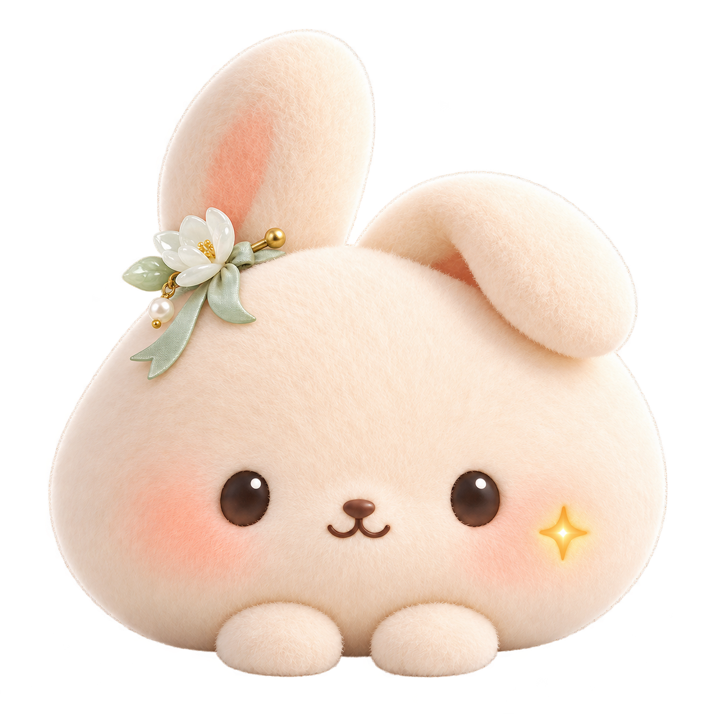
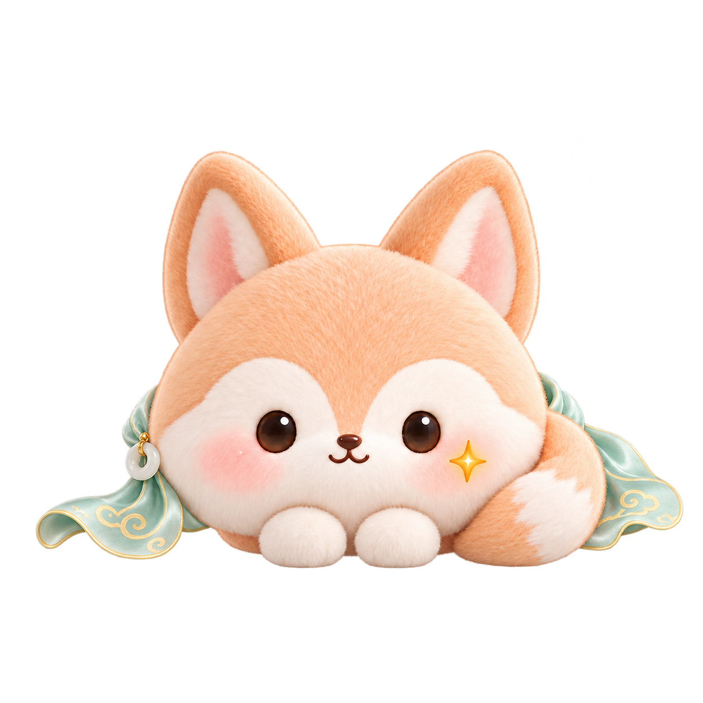
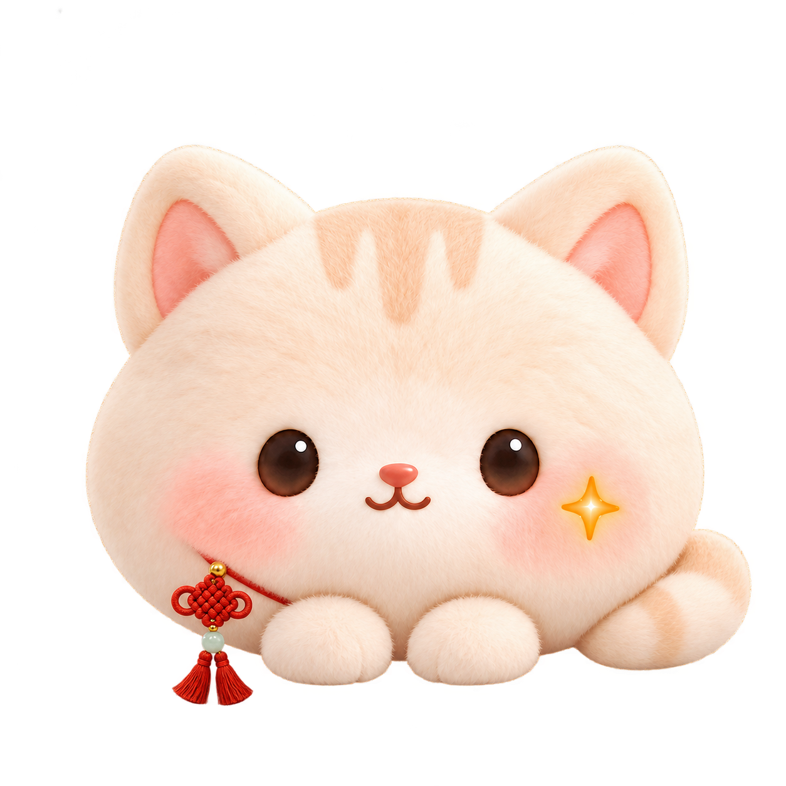
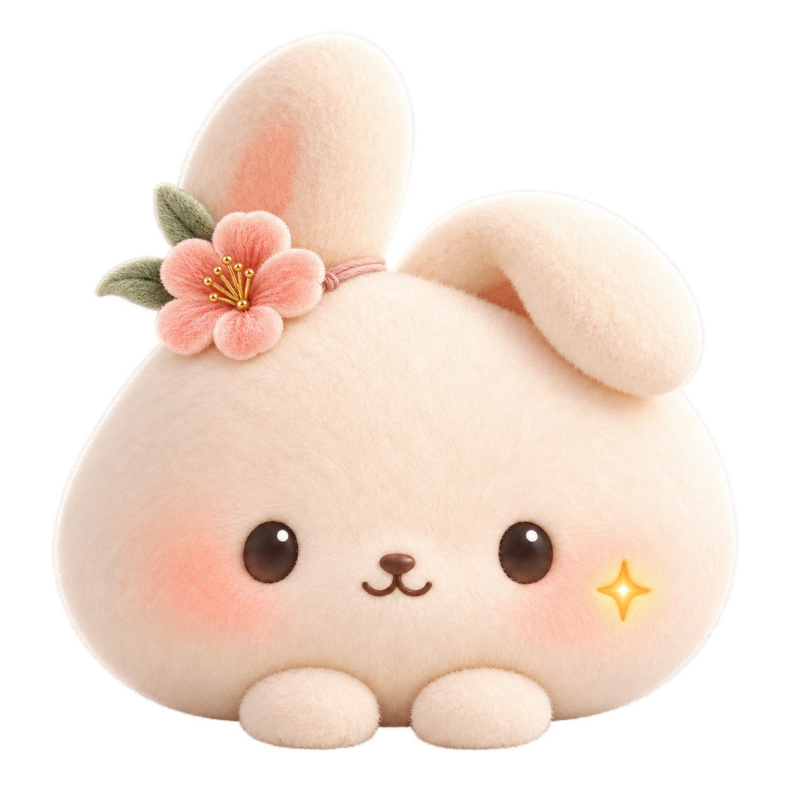
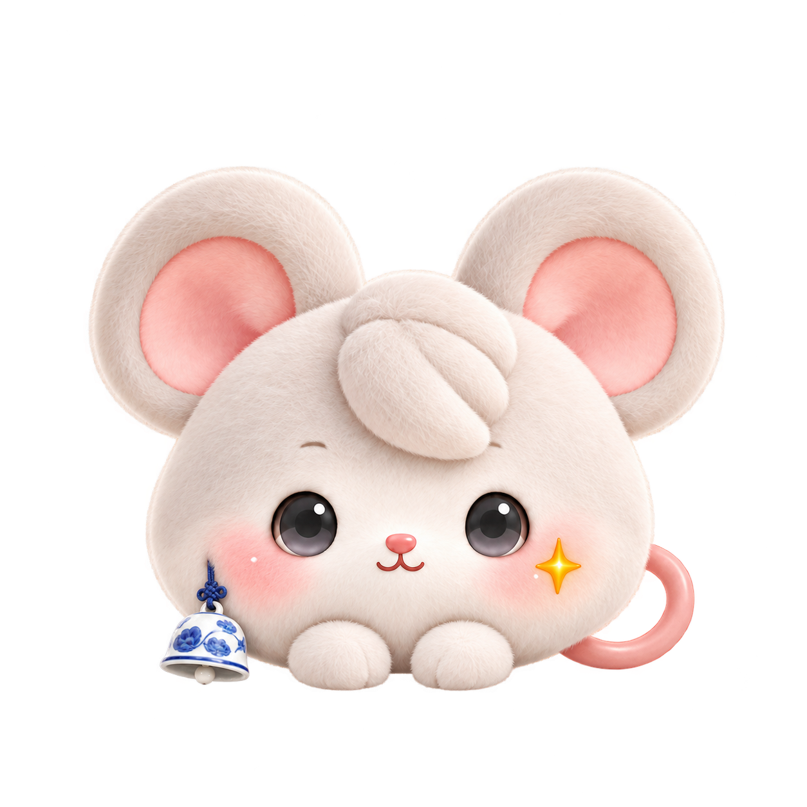
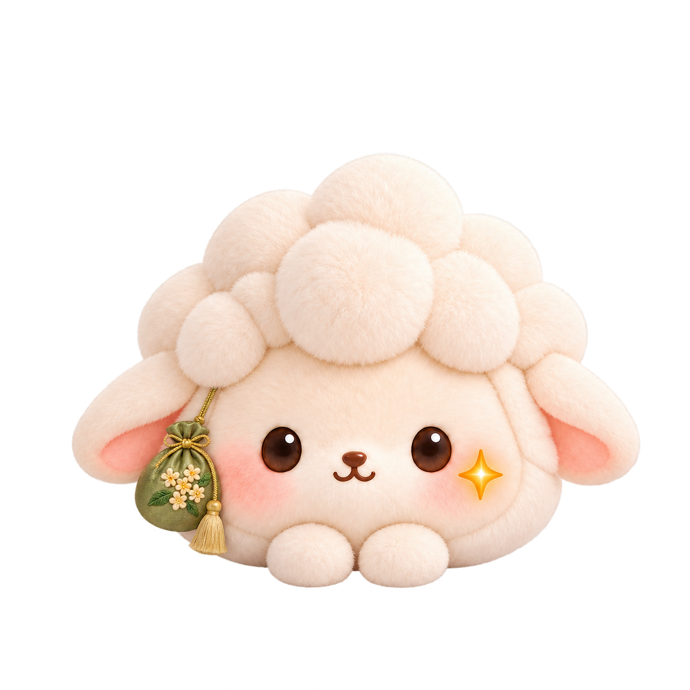
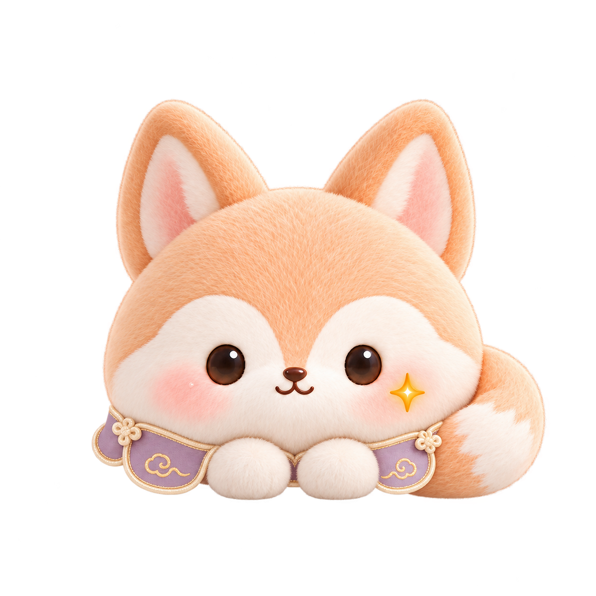
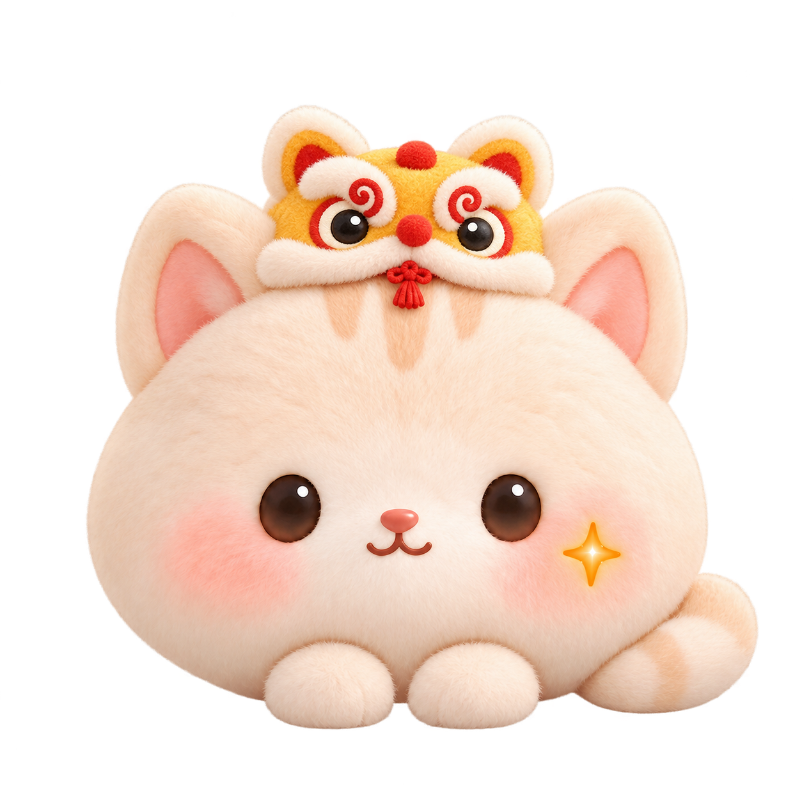

# Chinese-inspired Glowpet accessory concepts

Eight transparent PNG concepts exploring Chinese-inspired accessories for the existing plush pets. These are design previews; the game does not yet equip these accessories or allocate unique appearance combinations.

| Jade hairpin rabbit | Cloud-pattern silk fox |
| --- | --- |
|  |  |

| Chinese knot cat | Ronghua flower rabbit |
| --- | --- |
|  |  |

| Blue-and-white porcelain bell mouse | Osmanthus sachet sheep |
| --- | --- |
|  |  |

| Cloud collar fox | Lion-dance cap cat |
| --- | --- |
|  |  |

Generated using the built-in image generation tool from the existing [plush character assets](../../public/pets/deltax-soft-v1/). The prompts are preserved in [batch 1](chinese-elements-2026-10-21/prompts.json) and [batch 2](chinese-elements-v2-2026-10-21/prompts.json). Batch 1's cat attempt did not complete; the successful cat concept is in batch 2.

The [diversity design proposal](chinese-elements-v2-2026-10-21/diversity-design.json) describes compatible materials, palettes and accessory families. It proposes checking both duplicate trait combinations and visually similar thumbnails. Those allocation and deduplication rules are not implemented yet.
